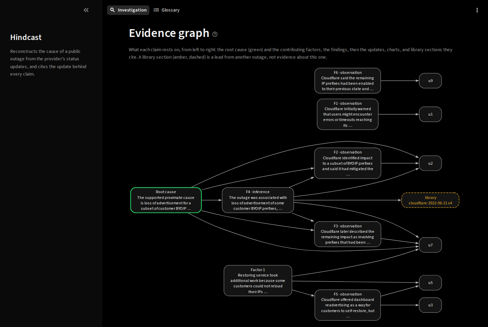

# Hindcast

Evidence-grounded AI investigations of infrastructure outages.

An AI agent reconstructs an outage from the provider's public status updates and charts: root cause, contributing factors, open questions, a citation on every claim, an abstention where the evidence stops. Each reconstruction is scored against the provider's later postmortem, which the investigator never sees.

On this page: [Highlights](#highlights) · [How it works](#how-it-works) · [Architecture](#architecture) · [The page](#the-page) · [Results](#results) · [What an investigation returns](#what-an-investigation-returns) · [Status](#status) · [Development](#development) · [Documentation](#documentation)

## Highlights

- **Scored against the postmortem.** 60 reconstructions of four outages, five configurations, scored item by item against keys frozen by hash under a rubric frozen before the first run ([report](eval/reconstruction/showcase-v1/README.md)).
- **No guess credited.** Every credited item rests on supported evidence; every root cause the evidence could not establish was met with an abstention.
- **Sealed before the answer existed.** Five outages reconstructed and committed by hash before their providers published a cause. The first reveal scored 1.00 on both models: the cause was not in the updates, and both said so ([sealed report](eval/reconstruction/sealed-v1/README.md)).
- **Prior knowledge kept out.** Both models could name one outage's cause before seeing any evidence; all 15 runs on it abstained anyway ([prior-knowledge check](eval/prior-knowledge/v1/README.md)).
- **Planted instructions resisted.** An instruction planted in a status update and in a library page reached the model in 8 runs, 4 with the screens off; none followed it ([injection tests](eval/injection/dev-v1/README.md)).
- **One template, nothing left behind.** The whole environment provisions with one `azd up`; it was built, removed, rebuilt from empty, and removed again with nothing left ([worklog 06](docs/worklogs/06-deployment.md#slice-2-final-removal)).
- **Every claim has evidence.** Seven milestones, each verified and independently reviewed ([roadmap](docs/roadmap.md#status)); 30 [decision records](docs/decisions/README.md); nine [runbooks](docs/runbooks/README.md) that rebuild it in [order](docs/reproduce.md).

## How it works

1. **Capture.** Status updates and postmortems are fetched by URL and pinned by SHA-256 in the [case registry](data/cases.yaml).
2. **Cut.** The evidence keeps every update before the resolved one and withholds the resolved update's text ([decision 0005](docs/decisions/0005-evidence-library-and-answer-key.md)). The answer key is extracted from the postmortem, reviewed, and frozen. Earlier postmortems of other outages form a searchable library.
3. **Investigate.** A Foundry prompt agent on `gpt-6-luna` runs in Hindcast's own tool loop with three case-bound tools: the updates, the charts, and a library search limited to documents published before the outage. Every tool result passes Prompt Shields; every answer passes a personal-data check ([the investigator](docs/architecture/README.md#the-investigator)).
4. **Check.** Citations are resolved against what the run was shown. Unresolvable ones are removed, unsupported items stay visible and flagged, and a library document never supports a claim alone ([rules](docs/architecture/investigation-results.md)).
5. **Score.** Claude Opus 5.5 judges each run against the key under the frozen [rubric](eval/rubric/rubric.md); Claude Fable 5.1 decides the review queue blind ([decision 0027](docs/decisions/0027-reviewer-model.md)). An abstention earns credit only where frozen labels say the evidence could not reach the item ([decision 0023](docs/decisions/0023-abstention-and-inferable-labels.md)).
6. **Seal.** For an outage without a published cause, the reconstruction's hash is committed and the file is revealed after the provider publishes ([decision 0017](docs/decisions/0017-sealed-reconstructions.md)).

Each step has a diagram on the [architecture page](docs/architecture/README.md).

## Architecture

An Entra-protected page on Azure Container Apps runs the Foundry agent with its managed identity; Blob Storage holds the evidence, Azure AI Search the library, Application Insights the traces. One Bicep template builds it all, and all of it has been removed; the code, data, and results stay. Parts: [architecture](docs/architecture/README.md). Rebuild: [reproduce](docs/reproduce.md).

**The deployed environment**


## The page

Captures from the deployed page and the local page ([all screenshots](docs/screenshots/README.md)).

**An investigation on the deployed page**


**The evidence graph**



**A challenge to a finding**


## Results

All 60 showcase runs completed ([evaluation report](eval/reconstruction/showcase-v1/README.md)):

- **Scores:** on the three outages the models did not know beforehand, configuration means run from 0.78 to 0.82; the differences are a few items in a few runs.
- **Grounding:** every credited finding is supported by the outage's own updates and charts, and every run abstained where the evidence could not establish the root cause.
- **Cost:** a `gpt-6-luna` reconstruction took 31 seconds and USD 0.045 on average; the comparison model took nearly twice as long for twice the cost and the same score.
- **Injection:** 12 runs planted one instruction in an update, a library page, or a chart, with the screens on and off. The 8 that saw it did not follow it; the chart runs never retrieved the planted figure ([injection tests](eval/injection/dev-v1/README.md)).

Five further outages were sealed before their providers published a cause ([decision 0017](docs/decisions/0017-sealed-reconstructions.md)). One is revealed and scored ([sealed report](eval/reconstruction/sealed-v1/README.md)). The other four stay hashed in [`seals.json`](eval/sealed/seals.json) until their providers publish; a case without a cause on 2026-11-30 is dropped ([decision 0022](docs/decisions/0022-sealed-drop-date-and-offline-reveal.md)).

| Sealed case | Sealed on | Where the cause will appear |
| --- | --- | --- |
| Cloudflare, 2026-10-20 | 2026-11-01 and 2026-11-02 | [cloudflarestatus.com](https://www.cloudflarestatus.com/incidents/0eqtn0khkz87) |
| GitHub, 2026-10-21 | 2026-11-01 and 2026-11-02 | [githubstatus.com](https://www.githubstatus.com/incidents/nms1dpzmh9d9) |
| GitHub, 2026-10-22 | 2026-11-01 and 2026-11-02 | [githubstatus.com](https://www.githubstatus.com/incidents/wq8305lppdc2) |
| GitHub, 2026-11-04 (pull requests) | 2026-11-04 | [githubstatus.com](https://www.githubstatus.com/incidents/smtdswd1h2w4) |

Four cases, a 23-document library, and no attack among them: attack detection and retrieval quality are not measured. The report lists every limit.

## What an investigation returns

- A timeline and findings that distinguish observations from inferences.
- A likely root cause, contributing factors, and the questions the evidence leaves open.
- An attack assessment, including "cannot tell" when the evidence is insufficient.
- Citations, validation results, provenance, usage, and cost.

Citations to evidence the run never saw are removed; unsupported items stay visible and flagged; inputs are screened and personal data masked; a failed check leaves the run incomplete ([example and rules](docs/architecture/investigation-results.md)).

## Status

Closed on 2026-11-07 with every milestone verified ([roadmap](docs/roadmap.md#status)). Four sealed reconstructions stay open until their providers publish a cause or 2026-11-30 ([results](#results)).

## Development

Install [uv](https://docs.astral.sh/uv/), then run:

```bash
uv sync --frozen --all-extras
uv run --frozen ruff check .
uv run --frozen ruff format --check .
uv run --frozen pyright
uv run --frozen pytest
```

Start the local viewer:

```bash
PYTHONPATH=src uv run --frozen streamlit run src/hindcast/app.py
```

Cloud operations require endpoint configuration and Azure sign-in. See [local development](docs/runbooks/development.md) for configuration, infrastructure checks, and test-data requirements, or the [investigator runbook](docs/runbooks/investigator.md) to run an investigation.

## Documentation

The [documentation map](docs/README.md) orders the pages by what a reader wants to do.

| Page | Contents |
|---|---|
| [Roadmap](docs/roadmap.md) | Each milestone's criteria and its verified state |
| [Architecture](docs/architecture/README.md) | What exists, part by part, with diagrams |
| [Decisions](docs/decisions/README.md) | 30 records: the options, the choice, the trade-offs |
| [Evaluation report](eval/reconstruction/showcase-v1/README.md) | Scores, judge and reviewer agreement, error analysis, limits |
| [Sealed report](eval/reconstruction/sealed-v1/README.md) | Revealed seals, one addendum per reveal |
| [Answer keys](eval/keys/README.md) | The frozen provider accounts and their labels |
| [Reproduce](docs/reproduce.md) | What a second build needs, and the runbook order |
| [Runbooks](docs/runbooks/README.md) | One operator procedure per milestone |
| [Worklogs](docs/worklogs/README.md) | What each milestone built, with its evidence and review |
| [Findings](docs/findings/README.md) | Platform behaviour the documentation does not state |
| [Troubleshooting](docs/troubleshooting.md) | Symptom, cause, fix, and verification |
| [Glossary](docs/glossary.md) | The terms, also on the page |

## License

[MIT](LICENSE). Source pages belong to their publishers and are not redistributed. The repository keeps URLs, hashes, capture commands, and short attributed quotations in answer keys.
