# Hindcast

Evidence-grounded AI investigations of infrastructure outages.

Hindcast's AI agent reconstructs outages from public status updates and charts, assessing likely causes and unanswered questions with citations to the evidence. Reconstructions are scored against the provider's later postmortem, which the investigator never sees.

## Target architecture

The design the project was built to. Milestone 6 built it in full on 2026-11-05 and removed it on 2026-11-06 ([roadmap](docs/roadmap.md#target-architecture)).



See the [roadmap](docs/roadmap.md) for each milestone's state, the [as-built architecture](#how-it-is-built-now) for how the system was built, and [reproduce](docs/reproduce.md) to build it again. Every Azure resource was removed by 2026-11-07; the code, the data, and the results stay.

## Status

- **Investigations:** captured evidence, searches of earlier postmortems, cited reconstructions, and follow-up challenges work. The page draws each run's timeline chart and evidence graph, and, run locally, shows a scored run next to its answer key ([slice 4](docs/worklogs/04-investigator.md#slice-4-the-view-parts)).
- **Safeguards:** citation checks, Prompt Shields, personal-data masking, traces, and per-run costs are implemented.
- **Deployment:** one template built the whole environment, and the page on Azure Container Apps, behind Entra sign-in, ran investigations and challenges with its managed identity ([live run](docs/worklogs/06-deployment.md#slice-2-live-run)); the environment was rebuilt from empty and removed again with nothing left ([removal](docs/worklogs/06-deployment.md#slice-2-final-removal)).
- **Closed on 2026-11-07:** every milestone is verified, and the resources built by hand were removed ([close](docs/worklogs/07-close.md)). One thread stays open on purpose: four sealed reconstructions wait for their providers' causes ([below](#results)).

Implementation evidence is in the [worklogs](docs/worklogs/).

## Results

All **60 showcase runs** completed across five configurations and four outages ([evaluation report](eval/reconstruction/showcase-v1/README.md), [injection tests](eval/injection/dev-v1/README.md)).

- **Scores:** on the three outages the models did not know beforehand, configuration means run from 0.78 to 0.82.
- **Grounding:** every credited finding is supported by the outage's own status updates and charts.
- **No guesses:** where the evidence could not establish the root cause, every run abstained.
- **Prior knowledge:** on the outage both models could name before seeing any evidence, all 15 runs kept that knowledge out of the root cause.

Reconstructions of **five further outages** were sealed before providers published their causes ([sealed reconstructions](docs/decisions/0017-sealed-reconstructions.md)). One has been revealed: the updates did not hold its cause, and both models said so instead of guessing, with no unsupported claim ([sealed report](eval/reconstruction/sealed-v1/README.md)). The other four stay hashed until their providers publish a cause, and a case without one on 2026-11-30 is dropped ([decision 0022](docs/decisions/0022-sealed-drop-date-and-offline-reveal.md)). Each hash is in [`seals.json`](eval/sealed/seals.json); the update, when it comes, appears on the provider's incident page:

| Sealed case | Sealed on | Where the cause will appear |
| --- | --- | --- |
| Cloudflare, 2026-10-20 | 2026-11-01 and 2026-11-02 | [cloudflarestatus.com](https://www.cloudflarestatus.com/incidents/0eqtn0khkz87) |
| GitHub, 2026-10-21 | 2026-11-01 and 2026-11-02 | [githubstatus.com](https://www.githubstatus.com/incidents/nms1dpzmh9d9) |
| GitHub, 2026-10-22 | 2026-11-01 and 2026-11-02 | [githubstatus.com](https://www.githubstatus.com/incidents/wq8305lppdc2) |
| GitHub, 2026-11-04 (pull requests) | 2026-11-04 | [githubstatus.com](https://www.githubstatus.com/incidents/smtdswd1h2w4) |

The dataset is small, and no showcase outage was an attack, so attack detection is not measured here. The evaluation report lists every limit.

## What an investigation returns

- A timeline and findings that distinguish observations from inferences.
- A likely root cause, contributing factors, and questions the evidence leaves open.
- An attack assessment, including “cannot tell” when evidence is insufficient.
- Citations, validation results, provenance, usage, and cost.

Three checks govern the answer:

- **Citations:** invalid references and references to evidence the run never saw are removed. Earlier postmortems cannot support a claim on their own.
- **Support:** unsupported items remain visible and are flagged; inference dependencies are checked.
- **Safety:** inputs are screened and personal data is masked. Failed checks or exceeded runtime limits leave the run incomplete.

See the [result example and exact validation rules](docs/architecture/investigation-results.md).

## How it is built now



## Development

Install [uv](https://docs.astral.sh/uv/), then run:

```bash
uv sync --frozen --all-extras
uv run --frozen ruff check .
uv run --frozen ruff format --check .
uv run --frozen pyright
uv run --frozen pytest
```

Start the local viewer:

```bash
PYTHONPATH=src uv run --frozen streamlit run src/hindcast/app.py
```

Cloud operations require endpoint configuration and Azure sign-in. See [local development](docs/runbooks/development.md) for configuration, infrastructure checks, and test-data requirements, or the [investigator runbook](docs/runbooks/investigator.md) to run an investigation.

## Documentation

| Guide | Contents |
|---|---|
| [Roadmap](docs/roadmap.md) | Milestones and progress |
| [Architecture](docs/architecture/) | Implementation and data flow |
| [Glossary](docs/glossary.md) | Terms by category, also on the page |
| [Decisions](docs/decisions/) | Design choices and tradeoffs |
| [Evaluation](eval/reconstruction/showcase-v1/README.md) | Scores, method, and limitations |
| [Answer keys](eval/keys/README.md) | Frozen provider accounts |
| [Runbooks](docs/runbooks/) | Setup, operation, and deployment |
| [Worklogs](docs/worklogs/) | Changes and verification |
| [Findings](docs/findings/) | Observed platform behavior |
| [Troubleshooting](docs/troubleshooting.md) | Failures and fixes |

## License

[MIT](LICENSE). Source pages belong to their publishers and are not redistributed. The repository keeps URLs, hashes, capture commands, and short attributed quotations in answer keys.
